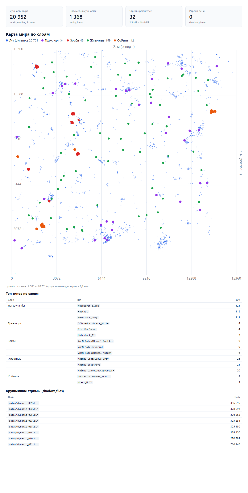
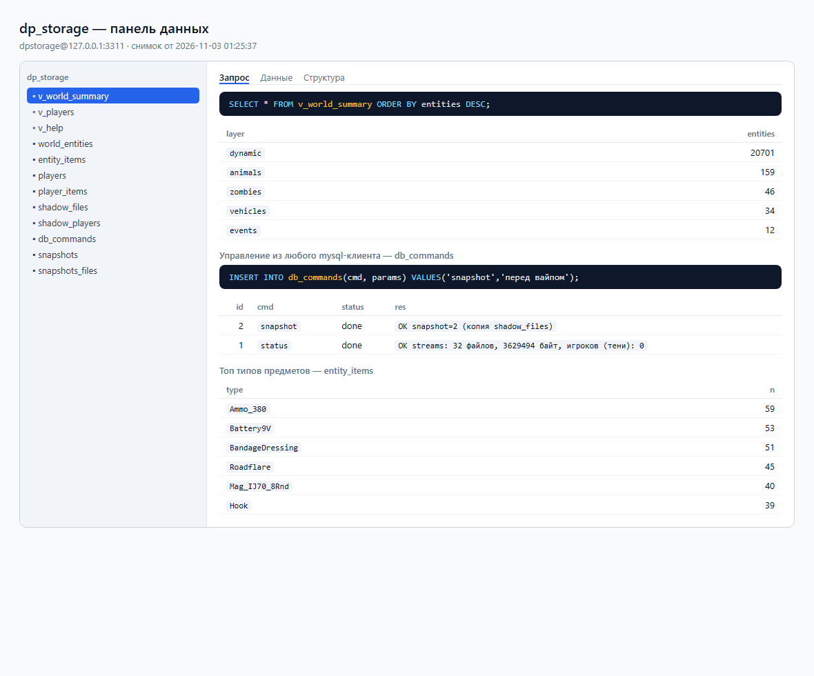

# DP_DBStorage

Серверный graft-мод DayZ: сохранение состояния сервера в **MariaDB** — полная
декомпозиция построчно (игроки с инвентарём, сущности мира, машины), без
бинарного `storage_1`. Работает поверх [KR_GRAFTED](https://github.com/KRdayzmodding/KR_GRAFTED):
C++-плагин `DP_DBStorage.grafted.dll` вызывается из Enforce-скриптов как обычные
нативные функции. Без ядра GRAFT мод компилируется пустым (`#ifdef`) и ничему
не мешает.

Разведочная база и предшественник — DP_Storage (живые операции с persistence,
экономика CE): там же подтверждены паттерны «воркер-поток + флаг-файлы»,
решёточный обход карты и параллельный доступ к players.db.

## Архитектура

Два режима persistence (config `mode`):

**`streams` (основной)** — подмена файлового слоя persistence СУБД. IAT-слоты
файловых функций образа движка (`CreateFileW`/`DeleteFileW`/`MoveFileExW`/
`GetFileAttributesW`/`SetFileAttributesW`/`CreateDirectoryW`, `fopen`)
перенаправляют пути `storage_<id>` в одноразовый кэш
`$profile\dpdb_cache`; кэш синхронизируется с MariaDB (таблица `shadow_files`,
FNV-хеш дедуп): на буте — недостающие файлы из СУБД (до первого обращения
движка), дальше воркер пушит изменения каждые `sync_period_sec`. Движок
полностью нативен: offlineDB/players.db, счётчики CE, «существующий мир»,
InitialSpawn гасится сам (при восстановленном мире `respawned:0`). Настоящий
`storage_<id>` не создаётся вовсе. При недоступной СУБД на старте — отказ от
перенаправления, движок работает с обычными файлами.

```
движок (CreateFileW …)            кэш $profile\dpdb_cache        MariaDB
   storage_<id>\…  ──IAT-redirect──►  data\*.bin, players.db ──воркер──► shadow_files
   чтение при старте ◄── cache_pull (только отсутствующие) ◄────────────┘
```

**`takeover`** — скриптовая полная декомпозиция: DbPlayerSaver/DbWorldSaver
(решётка + инвентарь) пишут построчные таблицы, DbRestorer спавнит мир из БД,
CE-хуки гасят бут-раскладку. Оставлен как слой читаемости и запасной путь.

```
Enforce (мод)                     C++ плагин (graft native)         MariaDB
──────────────                    ─────────────────────────         ───────
DbPlayerSaver  ──нативы-батчи──►  staging → очередь (coalesce) ──► воркер ──► SQL
DbWorldSaver   (решётка+инвентарь)                                  (транзакции)
MissionServer  ◄──нативы-чтение──  restore-кэш (слои, игроки по запросу)
```

## События мира (мониторинг в реальном времени)

Таблица `world_events` — журнал всего, что происходит: спавн предметов
(`item_spawn`, включая CE-раскладку при буте), перенос/подбор
(`item_move` с `old=`/`new=` в payload), смерти (`player_death`, `ai_death`,
`item_destroyed`), коннекты/дисконнекты, перемещения игроков (`player_pos`,
дельта > 3 м, опрос раз в секунду). Координаты значимы у сущностей в мире;
у предметов в чужом инвентаре они 0 — предмет не в мире.

```sql
SELECT type, COUNT(*) FROM world_events
 WHERE ts > NOW() - INTERVAL 1 HOUR GROUP BY type;
-- кто где умер за сутки:
SELECT ts, etype, ROUND(x), ROUND(z) FROM world_events
 WHERE type='player_death' AND ts > NOW() - INTERVAL 1 DAY;
```

Конфиг: `events = 1` (вкл/выкл), `event_retain_hours = 72` (удержание,
часами; 0 — вечно; чистка пачками раз в час). Выгрузка — буфер (65536,
переполнение считает дроп в `DbStatus`) → INSERT-пачки по 500 каждую секунду.

Производительность (замер стенда): бут-всплеск CE — 45 485 событий за 48 с
(~950 строк/с) записан без напряга; в рантайме 60 игроков — порядка
100–500 событий/с, это 3–5 мс CPU/с на сим-потоке и пачка INSERT раз в
1–2 с в фоне. Диск — единственная узкая сторона: сырой журнал без
удержания растёт гигабайтами в сутки, `event_retain_hours` обязателен.

## Визуализация

Две панели из живой базы — одной командой; живой режим `--serve` держит окно
администратора всегда актуальным (подробности: [docs/visualization.md](docs/visualization.md)):

```bat
py -3.12 tools\panels.py            # разовые панели-снимки
py -3.12 tools\panels.py --serve    # живой режим: localhost, автообновление
```

|  |  |
|---|---|
| Карта мира по слоям: лут/транспорт/зомби/животные/события, метрики, топ типов, стримы | Панель данных: `v_world_summary`, `db_commands` с результатами, топ предметов |

Панели — самодостаточные HTML без зависимостей; скриншоты выше сгенерированы
этим же инструментом на реальном стенде (DayZServer 1.30, Чернорусь).

## Конфиг `$profile:dp_dbstorage.cfg`

```
host = 127.0.0.1
port = 3306
user = dpstorage
password = секрет
database = dp_storage
mode = streams         # streams | takeover | mirror
sync_period_sec = 30
player_save_sec = 60
world_save_sec = 300
```

## Сборка

Тулчейн: VS Build Tools 2022 (C++ workload), LLVM (clang-cl 17+), CMake 3.30+,
Ninja, Mikero MakePbo.

```powershell
powershell -File deploy.ps1                                    # деплой в @dbstorage
cmake --preset tests -DGRAFT_SOURCE_DIR=C:/Grafted             # gtest без игры
cmake --build --preset tests; ctest --preset tests
```

## Статус

- `streams`: E2E на DayZServer 1.30 — посев (20890 лута) → кэш убит → рестарт
  из MariaDB → 28 слоёв восстановлено нативно, `Initially (re)spawned:0`,
  настоящий storage не создан, 32 файла/3.6 МБ в СУБД.
- `takeover`: E2E — 21 964 сущности построчно, восстановление спавном,
  теневые BLOB; прочие режимы — как слои поверх.
- Хвосты: сохранение игрока живым клиентом, db_commands (вайпы/кики), справка
  по fidelity script-API (`takeover`).
